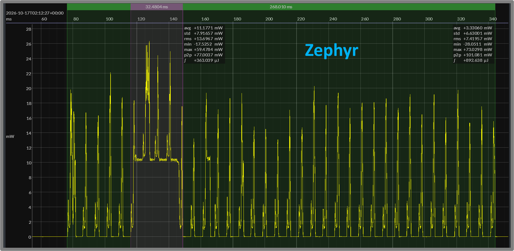
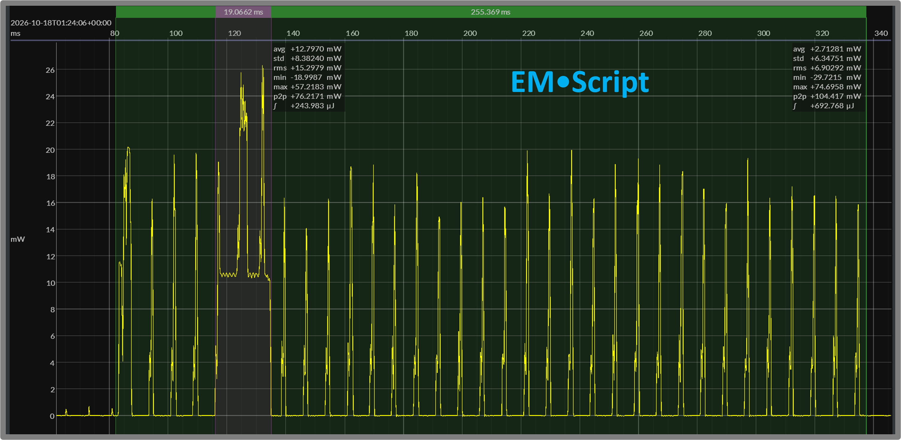
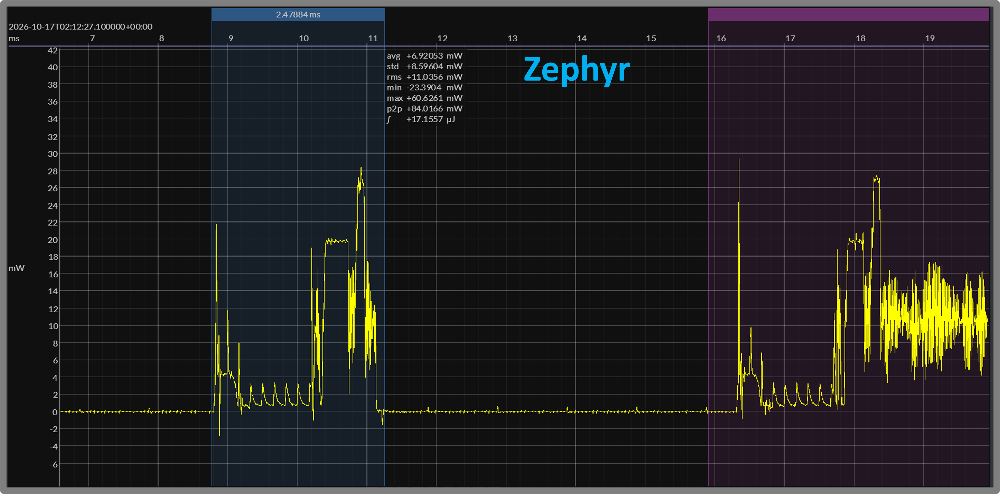
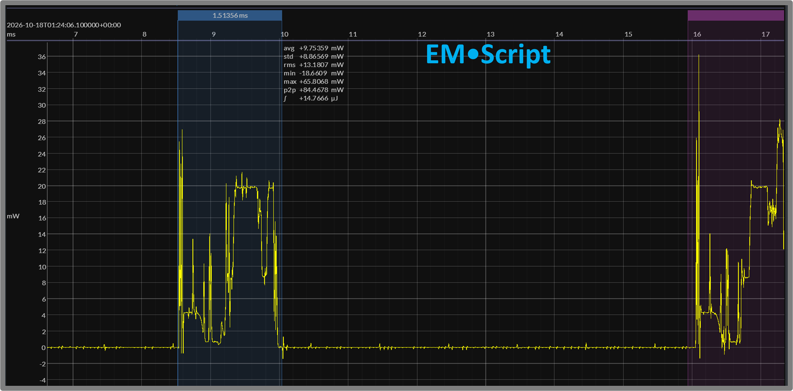

# EMR 11 — nRF52 Secure GATT: Zephyr versus EM•Script

**Report date:** 2026-10-18  
**Status:** Engineering results — point-in-time snapshot\
**Repository snapshot:** EM•porium `dev` at [`dac6930`](https://github.com/em-foundation/emporium/tree/dac6930e6788bb843670e73f8f6cedc05386faef)

## TLDR

- Compares Zephyr and EM•Script on the same nRF52 hardware.
- Uses BlueJoule-GATT-Secure with the same reference Central. [[EMR 10](010-bluejoule-gatt-secure-definition.md)]
- Measures at 3.0 V with a 7.5 ms connection interval.
- Both prepare public keys before connection.
- Both pair and establish encryption on every connection.
- Uses nRF52832 hardware AES for block encryption and packet CCM.
- P-256/ECDH runs in software; this device has no ECC accelerator.
- Secure connection energy is **693 µJ versus 893 µJ**.
- EM•Script uses approximately **22% less energy**.
- Transaction duration is **252 ms versus 267 ms**.
- The sustained crypto region is **18.7 ms versus 29.1 ms**.
- These regions include radio activity—not isolated ECDH.
- EM•Script code is **16.1 KB**, plus **2.1 KB constants**.
- Zephyr code is **132.4 KB**, plus **3.6 KB rodata**.
- Static data and BSS total **920 bytes versus 12.8 KB**.
- Historical basic-GATT measurements showed an **8% energy advantage**. [[EMR 5](005-nrf52-results-and-cross-generation-comparison.md)]
- The observed advantage widens to **22% with secure GATT**.
- Security increases both implementations' size and energy.
- These are engineering comparisons, not official benchmark scores.
- EM•Script combines lower connection energy with smaller code and static-data footprints.

## Related Reports

- [EMR 1 — BlueJoule-GATT v0 Definition](001-bluejoule-gatt-definition.md)
- [EMR 2 — Zephyr Reference Implementation](002-zephyr-reference-implementation.md) (historical nonsecure reference)
- [EMR 4 — EM•Scope Measurement Workflow](004-emscope-measurement-workflow.md)
- [EMR 5 — nRF52 Results and Cross-Generation Comparison](005-nrf52-results-and-cross-generation-comparison.md)
- [EMR 10 — BlueJoule-GATT-Secure Definition](010-bluejoule-gatt-secure-definition.md)

## 1. Purpose and Comparison Scope

This report compares Zephyr and EM•Script implementations of BlueJoule-GATT-Secure on the Nordic nRF52832. The workload adds pairing and link encryption to the original discover / write / read / disconnect transaction. [[EMR 10](010-bluejoule-gatt-secure-definition.md)]

The primary comparison uses the same peripheral hardware and reference Central. It examines:

- Code and constant storage.
- Static writable data.
- Connection energy and duration.
- The sustained pairing-computation region.
- Selected connection-event waveforms.

Local public keys are prepared before connection in both implementations. The measured transaction includes ECDH, the remaining pairing procedures, encryption setup, and the encrypted GATT exchange. Advertising and startup key preparation are excluded.

A secondary comparison uses earlier basic-GATT results to show how size and energy change with the secure workload. Those historical measurements are context, not a matched security-on/security-off experiment. [[EMR 5](005-nrf52-results-and-cross-generation-comparison.md)]

These are preliminary engineering measurements, not official BlueJoule / EM•erald scores. The report records the implementations as measured; it does not claim minimum achievable footprint, production-security readiness, or Bluetooth qualification.

## 2. Hardware Support and Software Implementations

The comparison uses the Nordic nRF52832, a 64 MHz Arm Cortex-M4 device. Its hardware assists symmetric cryptography and radio timing, but it has no elliptic-curve accelerator.

### Hardware Crypto Support

The EM•Script implementation uses:

- **AES ECB:** block encryption underlying CMAC and session-key derivation.
- **AES CCM:** packet encryption, decryption, and authentication.
- **RADIO/PPI coordination:** hardware-triggered packet-crypto operations.

P-256 public-key generation and ECDH execute in software. Preparing the local public key before connection removes that calculation from the measured transaction, but ECDH remains per pairing.

### Software Implementations

The Zephyr reference uses Nordic’s SoftDevice Controller and the Zephyr Bluetooth host. Its P-256 operations use the PSA crypto interface with the Oberon software implementation.

The EM•Script candidate uses the EM-Link controller, SMP procedures, and crypto providers. Its portable P-256 engine delegates arithmetic to Cortex-M4-specific math operations. CMAC uses the nRF52832 AES block.

This report compares the complete implementations, not isolated crypto-library performance.

### Hardware-Assisted Radio Timing

The EM•Script candidate also uses the RADIO peripheral’s hardware TIFS mechanism for 150 µs packet turnaround. TIMER1 and PPI support scheduled initial reception.

Hardware TIFS was introduced during the secure-GATT work; the historical basic-GATT candidate did not use it. Consequently, the basic-versus-secure comparison includes implementation evolution as well as the added security workload.

## 3. Measurement Conditions

The secure comparison uses:

- Nordic nRF52 DK / nRF52832 peripheral hardware.
- The same secure Zephyr reference Central.
- BLE 1M PHY.
- A 7.5 ms connection interval.
- Zero peripheral latency.
- Peripheral transmissions at 0 dBm.
- A nominal 3.0 V bench supply.
- Joulescope JS220 power capture.

Measured DUT voltage was approximately 3.0 V in both capture sets.

### Transaction Boundary

The measured window includes connection establishment, pairing, encryption setup, the GATT transaction, and disconnect. It ends as the peripheral returns to idle.

The window excludes:

- Preceding advertising.
- Startup public-key generation.
- Inter-connection waiting.
- The Central’s energy consumption.

Both implementations prepare their local public key before connection. Neither uses bonding to avoid pairing on subsequent transactions.

### Engineering Measurements

Each capture contains multiple complete transactions. The reported averages characterize repeated behavior rather than a single selected waveform. These are preliminary engineering measurements, not official BlueJoule scoring runs.

Capture-wide statistics use a consistent power-based extraction method, with small boundary margins. The figures show representative transactions selected in Joulescope. Their manually placed markers may produce slightly different durations and energies from the capture-wide averages.

Temporary diagnostic output and timing markers were removed for the power measurements.

## 4. Code and Static-Data Footprints

The secure implementations have substantially different code and static-data footprints.

| Component | EM•Script | Zephyr |
| --- | ---: | ---: |
| Code / text | 16,084 B | 132,440 B |
| Constants / rodata | 2,072 B | 3,612 B |
| **Code + constants** | **18,156 B** | **136,052 B** |
| Initialized data and writable tables | 116 B | 2,211 B |
| BSS | 804 B | 10,576 B |
| **Static data + BSS** | **920 B** | **12,787 B** |

The figures come from the EM•Script build summary and the saved secure Zephyr ELF/linker map. Section classifications differ between toolchains, so the table identifies the categories being compared.

### Flash Footprint

Including initialized-data storage, the EM•Script build reports approximately **18.3 KB** of flash sections. The Zephyr flash image spans approximately **139.3 KB**, including vectors, additional tables, initialized-data storage, and alignment.

The code-plus-constants comparison alone is approximately **18.2 KB versus 136.1 KB**.

### Writable Data

EM•Script uses approximately **0.9 KB** for initialized data and BSS, versus **12.8 KB** for Zephyr.

This comparison excludes Zephyr’s separately reserved stacks and uninitialized buffer areas. Its complete linked SRAM reservation is approximately **28.2 KB**.

The EM•Script application runs within a configured data-RAM region of approximately **16.4 KB** (16,384 bytes), shared by static allocations and its runtime stack. Stack high-water usage was not measured; 920 bytes is the static-data footprint, not the complete runtime RAM requirement.

### Scope of the Size Result

The EM•Script image includes the BLE controller, SMP procedures, software P-256, CMAC, packet-crypto integration, radio timing, and failure handling.

No dedicated code-size reduction pass was performed. These are the working implementations at this checkpoint, not minimum achievable sizes.

## 5. Whole-Connection Energy and Duration

The secure EM•Script implementation completes the transaction with less energy and a shorter elapsed time than the Zephyr reference.

| Capture-wide average | EM•Script | Zephyr |
| --- | ---: | ---: |
| Connection energy | **692.6 µJ** | **892.7 µJ** |
| Transaction duration | **251.8 ms** | **267.2 ms** |

EM•Script uses approximately **22% less connection energy** and completes the transaction approximately **6% sooner**.

### Representative Transactions

Figures 1 and 2 show individual transactions from the two capture sets. Advertising before connection is excluded.

The green selection covers the complete connection. The purple selection highlights the sustained pairing-computation region discussed in Section 6 below.

<strong>Figure 1 — Zephyr secure connection</strong> 268.010 ms · 892.638 µJ

<strong>Figure 2 — EM•Script secure connection</strong> 255.369 ms · 692.768 µJ

The figures use manually placed boundaries, including quiet margins around the transaction. Their displayed durations therefore differ slightly from the capture-wide extraction. The energy readings remain consistent with the averages.

### Reading the Comparison

Both waveforms contain repeated radio exchanges separated by low-power intervals. During pairing computation, the peripheral remains active between radio exchanges rather than returning to its ordinary sleep floor.

The result is not simply a lower radio-power peak. It reflects the energy integrated over the complete transaction: preparation, computation, packet exchanges, intervening waits, and return to idle.

The following sections examine the pairing-computation region and an individual connection event.

## 6. Pairing-Computation Region

The purple selections in Figures 1 and 2 highlight the sustained active region near the beginning of pairing. During this period, computation keeps the CPU active between radio exchanges.

| Selected purple region | EM•Script | Zephyr |
| --- | ---: | ---: |
| Duration | **19.066 ms** | **32.480 ms** |
| Energy | **243.983 µJ** | **363.039 µJ** |

For these selections, EM•Script spends approximately **13.4 ms less time** and **119 µJ less energy** in the highlighted region.

### What the Region Contains

Local public-key generation occurs before connection in both implementations. It is not part of these selections.

ECDH remains inside the pairing transaction and runs in software on the Cortex-M4. The nRF52832 has no hardware accelerator for this operation.

Pairing also requires AES-CMAC calculations for f4, f5, and f6, plus protocol processing and key derivation. These procedures occur at different stages; the purple selection should not be interpreted as containing all pairing work.

The radio continues servicing connection events while computation proceeds. Its activity contributes to both the elapsed time and integrated energy.

### Interpreting the Difference

The shorter sustained region is an important contributor to EM•Script’s lower whole-connection energy. It also allows the transaction to advance sooner.

These are waveform-defined regions, not measurements bracketed around individual crypto calls. Their manually selected boundaries differ from the automated extraction used for capture-wide statistics.

The figures therefore support a result about **integrated pairing behavior**. They do not, by themselves, establish the relative speed of the two isolated ECDH implementations.

## 7. Individual Connection-Event Comparison

Figures 3 and 4 zoom into selected events immediately before the sustained pairing-computation region. The blue selection covers each event’s wake-up, preparation, radio activity, and return to sleep. The purple region at the right provides context for the following computation.

<strong>Figure 3 — Zephyr pre-computation event</strong> 2.479 ms · 17.156 µJ

<strong>Figure 4 — EM•Script pre-computation event</strong> 1.514 ms · 14.767 µJ

| Selected event | EM•Script | Zephyr |
| --- | ---: | ---: |
| Duration | **1.514 ms** | **2.479 ms** |
| Energy | **14.767 µJ** | **17.156 µJ** |

The EM•Script selection is approximately **39% shorter** and consumes **14% less energy**.

### Event Shape

The Zephyr waveform shows an initial wake-up followed by a relatively long, lower-power preparation or waiting period before the higher-power radio activity.

The EM•Script waveform has a more compact pre-exchange region and returns to sleep sooner. The advantage is not a dramatically lower active-power level; it is less time spent completing the selected event.

The power trace alone does not identify every clock, CPU, or radio state within those regions.

### Comparison Boundary

These events occupy comparable positions before sustained pairing computation, but their packet contents have not been independently matched. They should not be described as a verified identical ATT operation or packet exchange.

The figures illustrate event-level behavior within the measured implementations. They are not an isolated radio benchmark or an average across all connection events.

## 8. Basic GATT versus Secure GATT

The earlier basic-GATT results provide context for the additional work introduced by pairing and encryption. The application transaction remains targeted discovery, a `Command` write, a `Status` read, and disconnect. [[EMR 1](001-bluejoule-gatt-definition.md)] [[EMR 10](010-bluejoule-gatt-secure-definition.md)]

### Connection Energy

| Implementation | Basic GATT | Secure GATT |
| --- | ---: | ---: |
| EM•Script | **≈283 µJ** | **≈693 µJ** |
| Zephyr | **≈308 µJ** | **≈893 µJ** |

Both implementations consume substantially more energy for the secure workload.

The approximate increase is:

- **EM•Script:** 2.45× the basic-GATT energy.
- **Zephyr:** 2.90× the basic-GATT energy.

EM•Script’s observed energy advantage therefore widens from approximately **8% with basic GATT** to approximately **22% with secure GATT**.

### Memory Growth

The historical nRF52 footprint figures come from EMR 5. [[EMR 5](005-nrf52-results-and-cross-generation-comparison.md)]

| Implementation / category | Basic GATT | Secure GATT |
| --- | ---: | ---: |
| EM•Script code + constants | 5,236 B | 18,156 B |
| Zephyr flash footprint | 108,840 B | 139,324 B |
| EM•Script static data + BSS | 272 B | 920 B |
| Zephyr reserved SRAM | 21,116 B | 28,152 B |

The memory categories retain their original accounting. In particular, Zephyr’s reserved SRAM includes stacks and buffers; EM•Script’s static-data figure does not include runtime stack usage.

EM•Script’s code-plus-constants footprint grows by approximately **12.9 KB**, or **3.5×**. The secure implementation remains substantially smaller than the Zephyr reference.

That growth includes cryptography, SMP and Link Layer procedures, packet-crypto integration, radio timing, and failure handling. It is not an isolated measurement of crypto-library size.

### Historical Comparison Boundary

The basic-GATT energy figures come from saved 3.0 V captures using fixed 150 ms analysis windows. The secure figures use the connection-boundary extraction described in Section 3 above.

These are also different implementation checkpoints. Hardware TIFS and other implementation changes accompanied the secure-GATT work.

The comparison therefore shows the observed change between the available basic and secure implementations. It does not isolate the incremental cost of security under otherwise identical firmware and measurement conditions.

## 9. Caveats and Conclusions

These results describe a working nRF52832 implementation checkpoint, not a minimum-size implementation or an official BlueJoule scoring run.

The principal limits are:

- Development security fixtures remain in the EM•Script candidate.
- Production-security readiness and Bluetooth qualification are not established.
- Runtime stack high-water usage was not measured.
- The selected individual events are not packet-matched.
- Pairing-region measurements include radio activity and protocol work.
- Historical basic-GATT comparisons use different implementation checkpoints and extraction boundaries.

Within that scope, the secure EM•Script candidate completes the measured transaction with approximately **22% less energy** than the Zephyr reference. It also completes sooner, with a shorter sustained pairing-computation region.

The footprint difference remains substantial: approximately **18.2 KB versus 136.1 KB of code and constants**, and **920 bytes versus 12.8 KB of static writable data**.

Adding security increases both implementations’ size and energy. In the available measurements, however, EM•Script’s relative energy advantage widens rather than disappears.

**The result combines lower connection energy with substantially smaller code and static-data footprints—even with software ECDH on a device without an elliptic-curve accelerator.**
