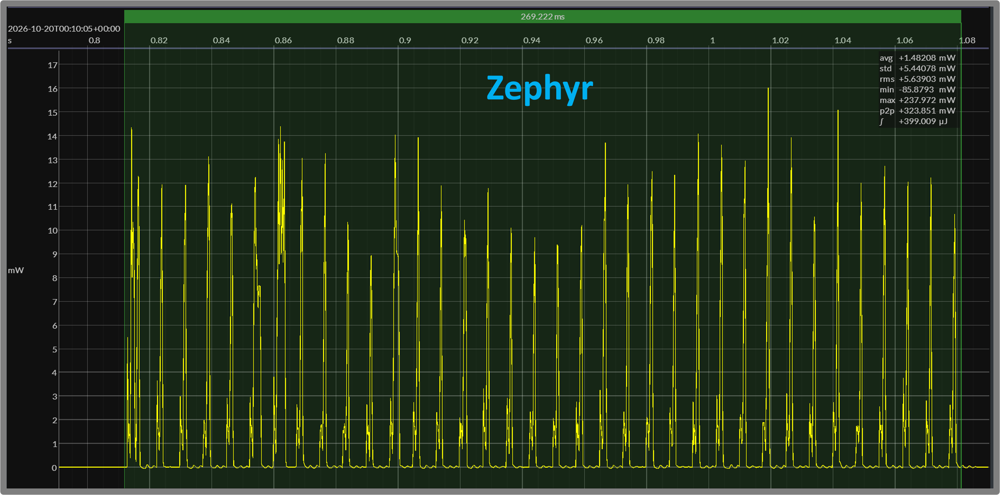
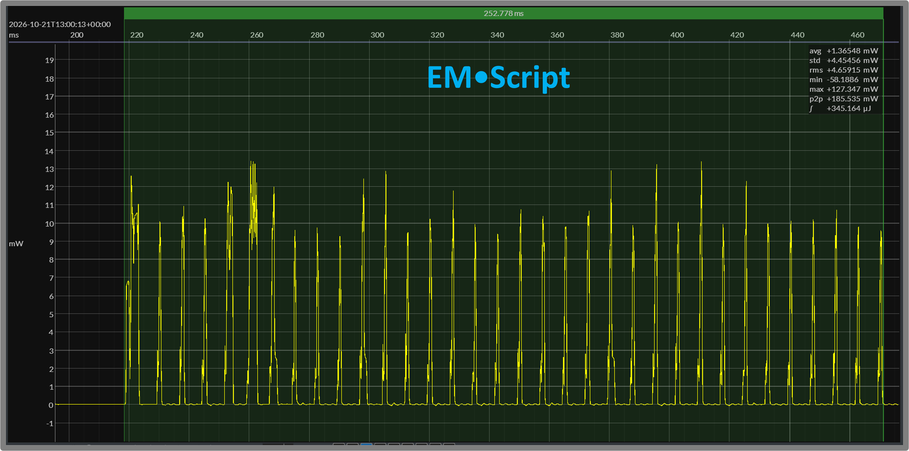
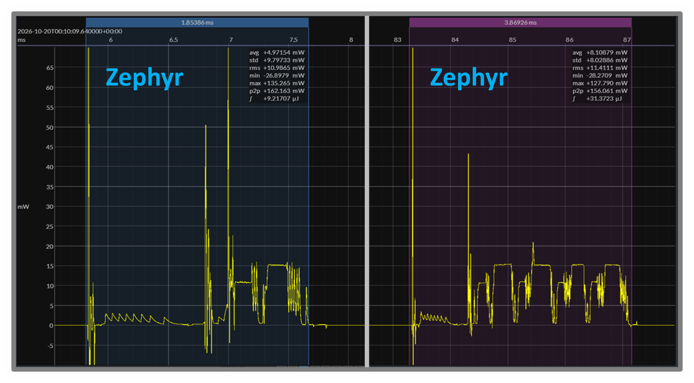
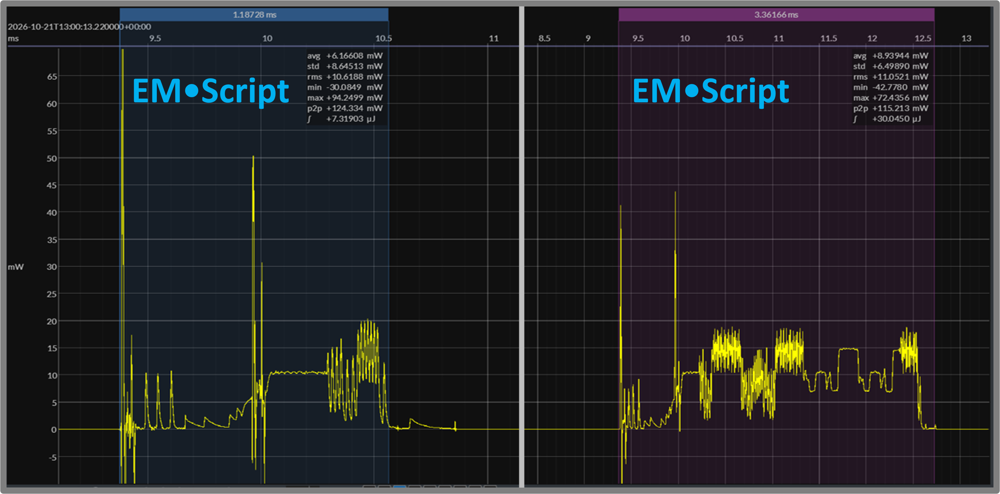

# EMR 12 — nRF54 Secure GATT: Zephyr versus EM•Script

**Report date:** 2026-10-21  
**Status:** Released — engineering results, point-in-time snapshot  
**Repository snapshot:** EM•porium `dev` at [`573160d`](https://github.com/em-foundation/emporium/tree/573160d9b10d2e9ebb4ef9fe8ab555904e37c9e4)  
**Target:** Nordic nRF54L15, Arm Cortex-M33

## TLDR

- Compares Zephyr and EM•Script on the same nRF54L15 hardware.
- Uses BlueJoule-GATT-Secure with the same reference Central. [[EMR 10](010-bluejoule-gatt-secure-definition.md)]
- Measures at 3.0 V with a 7.5 ms connection interval.
- Both prepare public keys before connection.
- Both pair and establish encryption on every connection.
- Neither uses bonding.
- Both use hardware acceleration for P-256/ECDH.
- EM•Script uses CRACEN for P-256.
- Hardware AES supports CMAC; hardware CCM protects packets.
- EM•Script uses hardware TIFS for packet turnaround.
- Secure connection energy averages **344 µJ versus 399 µJ**.
- EM•Script uses approximately **14% less energy**.
- Advertising and startup public-key generation are excluded.
- Energy averages cover **19 EM•Script and 17 Zephyr transactions**.
- Representative whole-connection figures support these averages.
- EM•Script text is **13.8 KB**, plus **6.8 KB constants**.
- Constants include **4.9 KB of CRACEN microcode**.
- Zephyr text is **143.3 KB**, plus **10.4 KB rodata**.
- Complete stored images are **21.8 KB versus 160.5 KB**.
- Static writable data and BSS total **836 bytes versus 14.8 KB**.
- Static-data figures exclude runtime stacks.
- These are engineering comparisons, not official benchmark scores.
- EM•Script combines lower connection energy with smaller footprints.

## Related Reports

- [EMR 1 — BlueJoule-GATT v0 Definition](001-bluejoule-gatt-definition.md)
- [EMR 4 — EM•Scope Measurement Workflow](004-emscope-measurement-workflow.md)
- [EMR 9 — nRF54 On-Chip Core Results: Cortex-M33 vs RISC-V](009-nrf54-on-chip-core-results-cortex-m33-vs-riscv.md) (historical basic-GATT results)
- [EMR 10 — BlueJoule-GATT-Secure Definition](010-bluejoule-gatt-secure-definition.md)

## 1. Purpose and Comparison Scope

This report compares Zephyr and EM•Script implementations of BlueJoule-GATT-Secure on the Nordic nRF54L15 Cortex-M33. The workload adds pairing and link encryption to the original discover / write / read / disconnect transaction. [[EMR 10](010-bluejoule-gatt-secure-definition.md)]

The primary comparison uses the same peripheral hardware and reference Central. It examines:

- Code and constant storage.
- Static writable data.
- Connection energy and duration.
- The pairing-computation region.
- Selected connection-event waveforms.

Both implementations prepare their local public key before connection. The measured transaction includes connection establishment, ECDH, the remaining pairing procedures, encryption setup, the encrypted GATT exchange, and disconnect. Advertising and startup key preparation are excluded. Neither implementation uses bonding to avoid pairing on subsequent connections.

A secondary comparison uses earlier basic-GATT results as historical context. Those measurements used an older EM-Link implementation and different measurement boundaries; they are not a matched security-on/security-off experiment. [[EMR 9](009-nrf54-on-chip-core-results-cortex-m33-vs-riscv.md)]

This report covers the Cortex-M33 application processor. It does not evaluate the nRF54L15’s FLPR RISC-V processor. A matched comparison of the current secure and nonsecure implementations, and further core comparisons, are left for future reports.

These are engineering measurements, not official BlueJoule / EM•erald scores. The report records the implementations as measured; it does not claim minimum achievable footprint, production-security readiness, or Bluetooth qualification.

## 2. Hardware Support and Software Implementations

The comparison uses the Nordic nRF54L15’s 128 MHz Arm Cortex-M33 application processor. The device provides hardware support for elliptic-curve cryptography, AES operations, and radio timing.

### Hardware Crypto Support

The EM•Script implementation uses:

- **CRACEN:** P-256 public-key generation and ECDH.
- **AES ECB:** block encryption underlying CMAC and session-key derivation.
- **AES CCM:** packet encryption, decryption, and authentication.

CRACEN initialization loads 4,892 bytes of accelerator microcode. That microcode is stored with the application and included in its constant-storage footprint. The provider explicitly shuts down the accelerator after each operation.

Both implementations prepare their local public key before connection. ECDH remains part of each measured pairing transaction.

### Software Implementations

The Zephyr reference uses Nordic’s SoftDevice Controller and the Zephyr Bluetooth host. Its P-256 operations use the PSA crypto interface with the CRACEN driver.

The EM•Script candidate uses the EM-Link controller, SMP procedures, and configurable crypto providers. A CRACEN provider implements the P-256 interface. The portable CMAC implementation delegates AES block encryption to the hardware ECB provider; the radio driver integrates hardware CCM with packet transmission and reception.

This report compares the complete implementations, not isolated crypto-library performance.

### Hardware-Assisted Radio Timing

The EM•Script candidate uses the RADIO peripheral’s hardware TIFS mechanism for 150 µs packet turnaround. Scheduled reception and asynchronous crystal startup allow the CPU to sleep during portions of the preparation for connection events.

These mechanisms are shared by secure and nonsecure operation. The historical basic-GATT implementation used a different radio-timing design, so its results also reflect implementation differences.

## 3. Measurement Conditions

The secure comparison uses:

- Nordic nRF54L15 DK peripheral hardware.
- The same secure Zephyr reference Central.
- The Cortex-M33 application processor.
- BLE 1M PHY.
- A 7.5 ms connection interval.
- Zero peripheral latency.
- Peripheral transmissions at 0 dBm.
- A nominal 3.0 V bench supply.
- Joulescope JS220 power capture.

Measured DUT voltage was approximately 3.0 V in both capture sets.

### Transaction Boundary

The measured window includes connection establishment, pairing, encryption setup, the encrypted GATT transaction, and disconnect. It ends as the peripheral returns to idle.

The window excludes:

- Preceding advertising.
- Startup public-key generation.
- Inter-connection waiting.
- The Central’s energy consumption.

Both implementations prepare their local public key before connection. Neither uses bonding to avoid pairing on subsequent transactions.

The workload uses LE Secure Connections with Just Works pairing. Fixed test fixtures support repeatable measurements; they are not a production key-management policy. [[EMR 10](010-bluejoule-gatt-secure-definition.md)]

### Capture Selection and Validation

Whole-connection energy averages cover 19 EM•Script transactions and 17 Zephyr transactions. The figures illustrate representative individual transactions; their displayed values need not equal the averages.

Saleae timing captures supported radio-timing development. Wireshark captures verified pairing, encryption setup, and the GATT exchange, including a command write of `0x04` followed by a status read of `0x84`.

For EM•Script, a debug signal also marks the connection lifecycle. Waveform inspection identifies the corresponding transaction boundaries in the Zephyr capture.

### Footprint Accounting

Footprints come from the linker maps and ELF artifacts for the measured implementations. Text, constants, complete stored images, and static writable storage are reported separately.

Static writable storage includes initialized data and BSS. It does not represent peak runtime RAM use or include runtime stacks.

## 4. Code and Static-Data Footprints

The linker artifacts show substantially smaller code, constant storage, and static writable storage for EM•Script.

| Component | EM•Script | Zephyr |
|---|---:|---:|
| Text | 13,804 bytes | 143,276 bytes |
| Constants / rodata | 6,772 bytes | 10,400 bytes |
| Complete stored image | 21,836 bytes | 160,548 bytes |
| Initialized writable storage | 116 bytes | 2,991 bytes |
| BSS | 720 bytes | 11,779 bytes |
| Static writable total | 836 bytes | 14,770 bytes |

The complete stored image includes vectors, code, constants, initialized data, and other stored sections. EM•Script’s constants include 4,892 bytes of CRACEN microcode.

Static writable totals exclude runtime stacks and do not represent peak RAM use. These figures describe the measured builds, rather than minimum achievable configurations.

## 5. Whole-Connection Energy and Duration

EM•Script uses approximately 14% less energy for the complete secure transaction.

| Measurement | EM•Script | Zephyr |
|---|---:|---:|
| Mean connection energy | 344.2 µJ | 399.3 µJ |
| Transactions averaged | 19 | 17 |
| Illustrated transaction energy | 345.2 µJ | 399.0 µJ |
| Illustrated window duration | 252.8 ms | 269.2 ms |

The averages cover connection establishment, pairing, encryption setup, encrypted service discovery and write/read operations, and disconnect. Advertising and startup public-key generation are excluded.

The figures show representative individual transactions. Their selection windows include the return to idle; the displayed durations describe those windows rather than exact packet-to-packet timing.

<strong>Figure 1A — Zephyr secure connection</strong> 269.222 ms · 399.009 µJ

<strong>Figure 1B — EM•Script secure connection</strong> 252.778 ms · 345.164 µJ

Both implementations complete the same secure workload. The following section examines the pairing region and typical individual connection events.

## 6. Pairing Activity and Typical Connection Events

Figures 2A and 2B contrast two portions of the secure transaction. The blue selection shows a short, typical connection event. The purple selection shows a more intensive pairing exchange, including computation and radio activity.

| Selected region | Measurement | EM•Script | Zephyr |
|---|---|---:|---:|
| Typical event — blue | Energy | 7.32 µJ | 9.22 µJ |
| | Duration | 1.19 ms | 1.85 ms |
| Pairing activity — purple | Energy | 30.05 µJ | 31.37 µJ |
| | Duration | 3.36 ms | 3.87 ms |

The typical event uses approximately **21% less energy** with EM•Script and occupies a **36% shorter window**. The more intensive pairing region uses approximately **4% less energy** and is **13% shorter**.

The purple region consumes roughly four times the energy of the blue event for EM•Script, and roughly three times for Zephyr. It illustrates the concentrated activity during pairing, compared with the shorter exchanges elsewhere in the connection.

Both implementations use CRACEN hardware acceleration for P-256/ECDH. The purple selections include surrounding software and radio activity; they are not isolated ECDH measurements or the complete pairing procedure. The selected regions are illustrative rather than an assertion of identical packet boundaries.

<strong>Figure 2A — Zephyr connection-event and pairing details</strong> Blue: typical event (left panel) · Purple: pairing activity (right panel)

<strong>Figure 2B — EM•Script connection-event and pairing details</strong> Blue: typical event (left panel) · Purple: pairing activity (right panel)

## 7. Basic GATT versus Secure GATT

Earlier nRF54 basic-GATT measurements also showed an energy advantage for EM•Script. The current secure comparison retains that advantage while adding pairing, encryption setup, and encrypted application traffic. [[EMR 9](009-nrf54-on-chip-core-results-cortex-m33-vs-riscv.md)]

The earlier measurements used an older EM-Link implementation with different radio timing and measurement boundaries. The secure implementation uses hardware TIFS and includes subsequent controller and power-management changes.

Consequently, subtracting the historical basic-GATT result from the secure result would not isolate the cost of security. A matched comparison using the current implementation in both modes is left for a future report.

## 8. Caveats and Conclusions

These results describe the measured builds and selected workload. They are engineering comparisons, not official BlueJoule / EM•erald scores.

The comparison has several limits:

- Whole-connection averages cover 19 EM•Script and 17 Zephyr transactions.
- Detail figures illustrate selected regions, not packet-matched comparisons.
- Static writable totals exclude stacks and peak runtime RAM use.
- Fixed security fixtures support testing, not production key management.
- Historical basic-GATT results use an older implementation and different boundaries.
- The results do not establish long-duration reliability or Bluetooth qualification.

On the nRF54L15 Cortex-M33, EM•Script completes the secure GATT workload with approximately **14% less whole-connection energy** than the Zephyr reference. It also uses substantially less code, constant storage, and static writable storage.

Both implementations benefit from hardware cryptography. EM•Script combines those facilities with its portable security components and hardware-assisted radio timing. The measured advantage therefore reflects the complete implementation, rather than software ECDH replacing hardware acceleration.

A future report can compare secure and nonsecure operation using the same current implementation and measurement boundaries. Evaluation of the FLPR RISC-V processor and comparisons across device generations are separate follow-up work.
