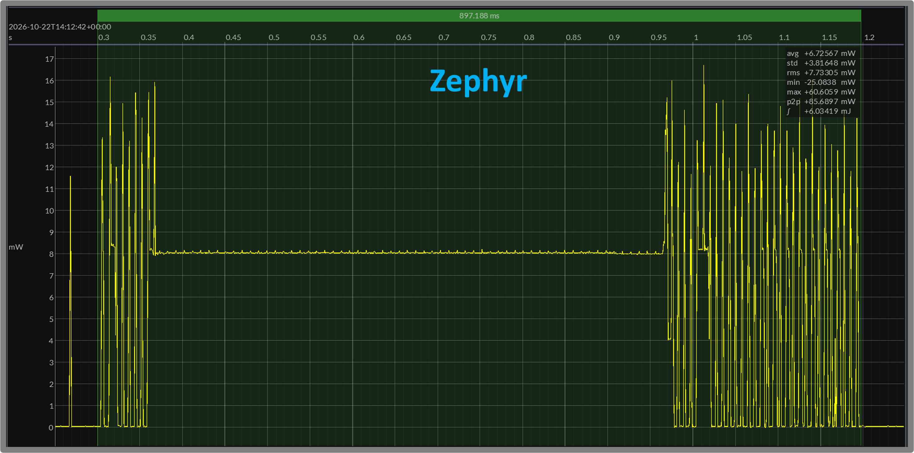
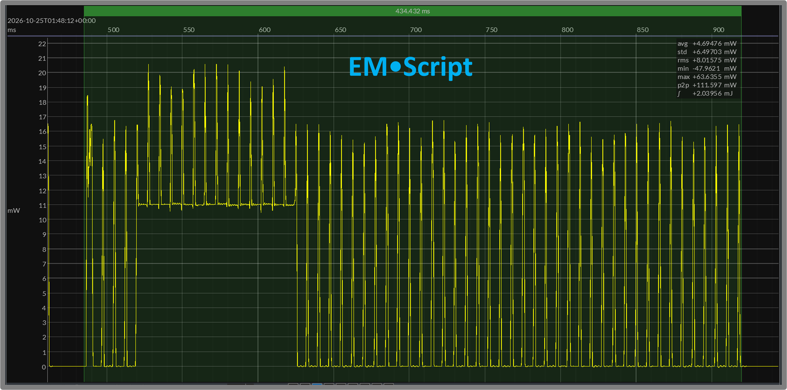
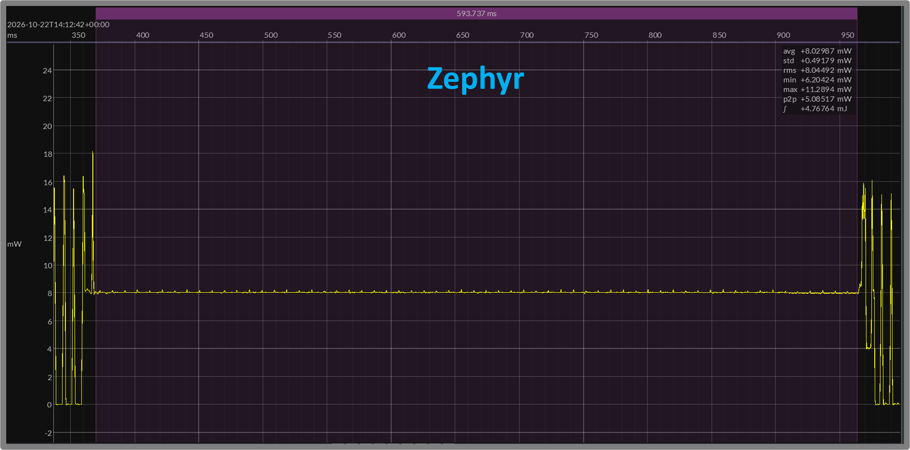
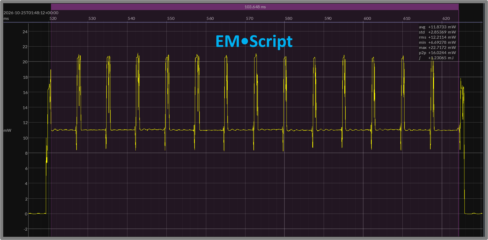
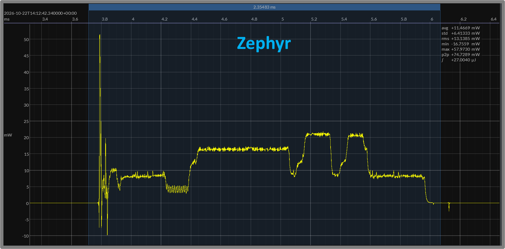
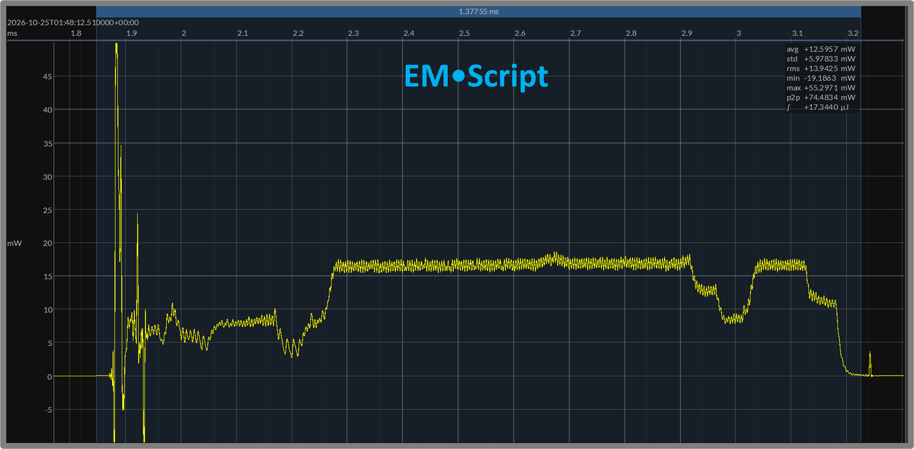

# EMR 13 — TI23 Secure GATT: Zephyr versus EM•Script

**Report date:** 2026-10-24  
**Status:** Preliminary draft — web review  
**Target:** Texas Instruments CC2340R5, Arm Cortex-M0+

## TLDR

- Compares Zephyr and EM•Script on the same TI23 hardware.
- Uses BlueJoule-GATT-Secure with the same reference Central.
- Measures at 3.0 V with a 7.5 ms connection interval.
- Runs on the CC2340R5’s 48 MHz Cortex-M0+.
- Uses the same Zephyr application and `secure.conf` approach.
- TI’s Zephyr distribution supplies platform support.
- Both prepare public keys before connection.
- Both pair and establish encryption on every connection.
- Neither uses bonding.
- Hardware AES supports CMAC and packet protection.
- P-256/ECDH runs in software; this device has no ECC accelerator.
- EM•Script uses Cortex-M0-specific arithmetic operations.
- Mean energy: **Zephyr 6.034 mJ; EM•Script 2.041 mJ**.
- EM•Script uses approximately **66% less connection energy**.
- Mean duration: **Zephyr 890 ms; EM•Script 432 ms**.
- EM•Script completes the transaction approximately **51% sooner**.
- Energy averages cover **12 Zephyr and 19 EM•Script transactions**.
- Advertising and startup public-key generation are excluded.
- Representative whole-connection figures support these averages.
- EM•Script’s stored image is approximately **29.7 KB**.
- Required radio firmware patches account for **8.4 KB**.
- A separate TI configuration block occupies **2 KB**.
- EM•Script static writable data and BSS total **956 bytes**.
- Static-data figures exclude runtime stacks.
- These are preliminary engineering results, not official scores.
- EM•Script combines lower connection energy with a smaller footprint.

[← EM•Reports index](README.md)

## Related Reports

- [EMR 1 — BlueJoule-GATT v0 Definition](001-bluejoule-gatt-definition.md)
- [EMR 4 — EM•Scope Measurement Workflow](004-emscope-measurement-workflow.md)
- [EMR 7 — TI CC2340R5 SimpleLink, Zephyr, and EM•Script Results](007-ti-cc2340r5-results.md)
- [EMR 8 — TI CC2340R5 Connection-Event Drilldown](008-ti-cc2340r5-connection-event-drilldown.md)
- [EMR 10 — BlueJoule-GATT-Secure Definition](010-bluejoule-gatt-secure-definition.md)
- [EMR 11 — nRF52 Secure GATT](011-nrf52-secure-gatt-zephyr-vs-emscript.md)
- [EMR 12 — nRF54 Secure GATT](012-nrf54-secure-gatt-zephyr-vs-emscript.md)

## 1. Purpose and Comparison Scope

This report compares Zephyr and EM•Script implementations of BlueJoule-GATT-Secure on the Texas Instruments CC2340R5. It follows the comparison framework used for the nRF52 and nRF54 in [EMR 11](011-nrf52-secure-gatt-zephyr-vs-emscript.md) and [EMR 12](012-nrf54-secure-gatt-zephyr-vs-emscript.md).

Both implementations use the same peripheral hardware and secure reference Central. The workload establishes a connection, performs LE Secure Connections pairing, enables link encryption, discovers the benchmark service and characteristics, writes `Command`, reads `Status`, and disconnects.

The comparison examines connection energy and duration, code and constant storage, static writable data, and selected pairing and radio-event waveforms.

Both implementations prepare their local public key before connection. The measured transaction includes ECDH and the remaining pairing and encrypted GATT work. Advertising, startup key preparation, inter-connection waiting, and the Central’s energy consumption are excluded.

These are preliminary engineering results, not official BlueJoule / EM•erald scores. They describe the measured implementations and provide a basis for further investigation and review with TI.

## 2. Hardware Support and Software Implementations

### Hardware

The comparison uses the TI CC2340R5 LaunchPad. Its 48 MHz Arm Cortex-M0+ provides hardware AES support but no elliptic-curve accelerator. P-256 public-key generation and ECDH therefore execute in software.

The radio also requires firmware patches stored with the application. These contribute to the reported Flash footprint.

### Zephyr Reference

The reference uses the same portable BlueJoule-GATT application and security-overlay approach used in the preceding comparisons. TI’s SimpleLink Zephyr distribution supplies the platform integration, including TI controller and crypto support.

The saved build artifacts identify:

| Item | TI reference |
|---|---|
| Zephyr kernel | `3.7.0` |
| TI build version | `v3.7.0-ti-9.14.02_ea` |
| Board target | `lp_em_cc2340r5` |
| Zephyr SDK toolchain | `0.16.8` |
| Configuration | `prj_ti23.conf` plus `prj_secure.conf` |

The configuration files currently reside in the `bluejoule-gatt-dev` repository at `peripheral/prj_ti23.conf` and `peripheral/prj_secure.conf`.

The security overlay enables pairing without bonding or persistent settings. Using the same application-level workload does not imply identical controller or crypto implementations across vendor distributions.

### EM•Script Candidate

The candidate uses the EM-Link controller, SMP procedures, and configurable crypto providers. Its portable P-256 engine delegates arithmetic to Cortex-M0-specific operations. Hardware AES supplies block encryption for CMAC and packet CCM.

The TI radio driver coordinates packet protection through deferred processing between connection events. Section 6 discusses this design and the software-computation demands of the platform.

Both implementations prepare the peripheral public key before connection and perform ECDH during each pairing transaction. This report compares the complete implementations rather than isolated crypto-library performance.

## 3. Measurement Conditions

The secure comparison uses:

- TI CC2340R5 LaunchPad peripheral hardware.
- The same secure Zephyr reference Central.
- BLE 1M PHY.
- A 7.5 ms connection interval.
- Zero peripheral latency.
- Peripheral transmissions at 0 dBm.
- A nominal 3.0 V bench supply.
- Joulescope JS220 power capture.
- EM•Script execution from Flash.

### Transaction Boundary

The measured window includes connection establishment, pairing, encryption setup, encrypted service discovery and write/read operations, and disconnect. It ends as the peripheral returns to idle.

The window excludes:

- Preceding advertising.
- Startup public-key generation.
- Inter-connection waiting.
- The Central’s energy consumption.

Both implementations prepare their local public key before connection. Neither uses bonding to avoid pairing on subsequent transactions.

### Capture Selection and Validation

Whole-connection averages cover **12 Zephyr transactions and 19 EM•Script transactions**. Startup activity and the final incomplete transaction in each recording are excluded.

The same power-based boundary extraction and integration method is applied to both captures. Small changes to the boundary margins have negligible effect on the reported energy.

The figures show representative individual transactions selected in Joulescope. Their manually placed boundaries may produce slightly different energies and durations from the capture-wide averages.

Functional testing verified pairing, encryption setup, discovery, a command write of `0x04`, a status read of `0x84`, and clean disconnect.

Temporary radio and crypto timing markers were removed for the power measurements.

### Footprint Accounting

Footprints come from the linker maps and executable artifacts. Text, constants, complete stored images, and static writable storage are reported separately.

Static writable storage includes initialized data and BSS. It excludes runtime stacks and does not represent peak RAM use.

## 4. Code and Static-Data Footprints

The linked artifacts show substantially smaller code, constant storage, and static writable storage for EM•Script.

| Component | Zephyr | EM•Script |
|---|---:|---:|
| Text | 156,640 B | 19,148 B |
| Constants / rodata | 15,404 B | 10,232 B |
| Stored Flash image, excluding CCFG | **174,436 B** | **29,668 B** |
| Separate TI configuration block / CCFG | 2,048 B | 2,048 B |
| Initialized writable storage | 1,942 B | 148 B |
| BSS | 6,351 B | 808 B |
| **Static writable total** | **8,293 B** | **956 B** |

The stored Flash figures include vectors, code, constants, initialized-data storage, other stored tables, and alignment. They exclude executable-file debug information and the separately addressed TI configuration block.

### Required Radio Firmware

EM•Script’s constants include **8,444 bytes of TI radio firmware patches**, approximately 28% of its stored Flash image. These patches are required for radio operation and are already included in the table.

The separate 2,048-byte CCFG block configures the device and is present in both builds.

### Writable Storage

Zephyr’s initialized-writable figure includes writable kernel and driver tables, rather than only its ordinary data section.

Its separate `noinit` section reserves another **22,972 bytes** for storage outside the initialized-data and BSS categories. That reservation is excluded from the static writable total shown above.

Static writable storage is not the complete runtime RAM requirement. Runtime stacks and stack high-water usage are not included in the comparison.

### Scope of the Size Result

The EM•Script image includes the BLE controller, GATT handling, SMP procedures, software P-256, CMAC, packet protection, and MCU/radio support.

No dedicated code-size reduction pass was performed. These are the working implementations at this checkpoint, not minimum achievable configurations.

## 5. Whole-Connection Energy and Duration

EM•Script uses approximately **66% less energy** for the complete secure transaction and completes it approximately **51% sooner**.

| Measurement | Zephyr | EM•Script |
|---|---:|---:|
| Mean connection energy | **6.034 mJ** | **2.041 mJ** |
| Transactions averaged | 12 | 19 |
| Mean transaction-window duration | **890.1 ms** | **432.1 ms** |
| Illustrated transaction energy | 6.034 mJ | 2.040 mJ |
| Illustrated window duration | 897.2 ms | 434.4 ms |

The averages cover connection establishment, pairing, encryption setup, encrypted service discovery and write/read operations, and disconnect. Advertising and startup public-key generation are excluded.

The mean energy ratio is approximately **2.96×**: EM•Script consumes roughly one-third of the Zephyr reference’s energy for this workload.

### Representative Transactions

Figures 1A and 1B show individual transactions from the two capture sets. Their manually selected windows include the return to idle; the displayed values need not exactly equal the capture-wide averages.

<strong>Figure 1A — Zephyr secure connection</strong> 897.188 ms · 6.03419 mJ

<strong>Figure 1B — EM•Script secure connection</strong> 434.432 ms · 2.03956 mJ

### Reading the Comparison

The largest visual difference is the much longer sustained computation region in the Zephyr trace. EM•Script completes its computation sooner while continuing to service radio events.

The result is an integrated whole-connection measurement. It includes computation, radio exchanges, preparation, and intervening waits; it is not simply a comparison of peak power or isolated ECDH execution time.

The following sections examine the crypto implementation and selected portions of these waveforms.

## 6. Pairing Computation and Packet Cryptography

The TI23 implementation presented two distinct challenges: software ECDH on a 48 MHz Cortex-M0+ and packet protection around the radio’s 150 µs receive-to-transmit turnaround.

### Software P-256 and ECDH

Both implementations prepare the peripheral public key before connection. ECDH remains part of each measured pairing transaction.

EM•Script’s **configurable P-256 framework** separates the elliptic-curve algorithm from its arithmetic operations. The framework includes portable arithmetic and optimized backends for processor architectures such as Cortex-M0, Cortex-M4, and Cortex-M33.

These backends are architecture-specific rather than vendor-specific. The TI23 configuration selects the Cortex-M0 arithmetic backend; the same backend can serve other compatible Cortex-M0 devices without changing the higher-level P-256 algorithm.

The selected sustained computation region in the EM•Script power trace lasts approximately **104 ms**, with radio exchanges continuing during that period (Figure 2B).

The Zephyr trace shows a much longer computation plateau, without clearly visible radio bursts through much of it. This region is a major contributor to the whole-connection energy difference.

### Selected Pairing-Computation Regions

Figures 1A and 1B show the computation regions within the complete connections. Figures 2A and 2B zoom into those regions, selected in purple, with Zephyr first and EM•Script second.

| Selected computation region | Zephyr | EM•Script |
|---|---:|---:|
| Energy | 4.76764 mJ | 1.23065 mJ |
| Duration | 593.737 ms | 103.648 ms |

<strong>Figure 2A — Zephyr pairing-computation region</strong> 593.737 ms · 4.76764 mJ

<strong>Figure 2B — EM•Script pairing-computation region</strong> 103.648 ms · 1.23065 mJ

These waveform-defined regions include surrounding software work and any radio activity. They are not isolated ECDH measurements.

The absence of clearly visible radio bursts through much of the Zephyr plateau is a waveform observation. It does not, by itself, establish the controller’s internal scheduling behavior.

### Hardware AES and Software Packet Processing

The CC2340R5 provides AES block acceleration, but the EM•Script implementation performs the surrounding CCM processing in software. That work includes constructing authentication and counter blocks, combining the AES results with payload data, and verifying the packet’s message integrity check (MIC).

This processing varies with packet length. Performing receive decryption, authentication, response preparation, and transmit encryption inline did not meet the required radio turnaround timing in the tested implementation.

### Deferred Packet Protection

The working design separates the immediate radio exchange from processing the newly received packet:

- The radio transmits a previously prepared reply.
- After TX completes, a driver-owned fiber decrypts the incoming packet.
- Verified plaintext is delivered to the controller.
- Outgoing packet protection is prepared for a later exchange.

Before a prepared reply exists, an empty link-layer PDU maintains the exchange without acknowledging an unverified payload.

The existing RX buffer remains owned by deferred processing until that work finishes. A guard prevents another receive from reusing it while processing is pending. Link-layer acknowledgments, retransmissions, and packet counters remain coordinated with this pipeline.

Encrypted control packets follow the same verification requirement as application traffic. In particular, disconnect waits until the acknowledgment of a verified terminate packet has been transmitted.

### Interpreting the Reference Result

The Zephyr application uses the same security workload, but its controller and crypto implementation differ. Inspection of the saved executable identified software packet-crypto processing supported by hardware AES, with encryption before transmit queuing and decryption through deferred controller processing.

The complete measurements show that the EM•Script implementation finishes substantially sooner and consumes less energy. They do not establish how much of the Zephyr computation interval belongs to individual crypto routines or surrounding software.

That attribution remains a useful subject for review with TI. The result describes the measured reference build, not a limit on the CC2340R5 or on achievable Zephyr performance.

## 7. Typical Connection Events

Figures 3A and 3B show typical connection events before the sustained pairing computation examined in Section 6. The blue selections cover wake-up, preparation, packet exchange, and return to sleep, with Zephyr first and EM•Script second.

| Selected typical event | Zephyr | EM•Script |
|---|---:|---:|
| Energy | 27.0040 µJ | 17.3440 µJ |
| Duration | 2.35483 ms | 1.37755 ms |

<strong>Figure 3A — Zephyr typical connection event</strong> 2.35483 ms · 27.0040 µJ

<strong>Figure 3B — EM•Script typical connection event</strong> 1.37755 ms · 17.3440 µJ

The events are selected from comparable positions in the transaction, with roughly comparable complexity. Their energy and duration illustrate ordinary event-level behavior alongside the more intensive computation regions shown in Figures 2A and 2B.

Unless independently matched to packet contents, these selections should not be interpreted as identical packet exchanges or an average across all connection events. An earlier packet-matched basic-GATT event comparison is documented separately in [EMR 8](008-ti-cc2340r5-connection-event-drilldown.md).

## 8. Basic GATT versus Secure GATT

Earlier TI23 basic-GATT measurements provide context for the additional work introduced by pairing and encryption. The application transaction remains service discovery, a `Command` write, a `Status` read, and disconnect.

[EMR 7](007-ti-cc2340r5-results.md) documents the earlier same-device basic-GATT comparison across TI SimpleLink, Zephyr, and EM•Script, including program footprints and required radio firmware patches. [EMR 8](008-ti-cc2340r5-connection-event-drilldown.md) examines a matched basic-GATT ATT Read Request event, showing the software-processing tail and a secondary SRAM-execution comparison.

Those reports provide historical context. The basic-GATT numbers below come from the saved capture metadata identified in this section, rather than the older measurement sets quoted in those reports.

### Connection Energy

| Implementation | Historical basic GATT | Current secure GATT |
|---|---:|---:|
| Zephyr | **465.2 µJ** | **6,034.2 µJ** |
| EM•Script | **275.4 µJ** | **2,041.4 µJ** |

The historical basic-GATT figures average 10 transactions per implementation. The current secure figures average 12 Zephyr and 19 EM•Script transactions.

EM•Script’s observed energy advantage widens from approximately **41% with basic GATT** to approximately **66% with secure GATT**.

The secure result consumes approximately **13.0×** the historical basic-GATT energy for Zephyr and **7.4×** for EM•Script.

### Historical Comparison Boundary

The basic-GATT figures come from the saved 3.0 V captures in `bluejoule-gatt/captures/ti-cc2340r5-zephyr/3V0-J` and `ti-cc2340r5-emscript/3V0-J`. They use fixed 150 ms analysis windows that exclude preceding advertising. The secure figures use the whole-connection extraction described in Section 3.

These are different implementation checkpoints. Controller and radio changes accompanied the secure-GATT work, so the comparison does not isolate the incremental cost of security. The same distinction between historical context and a matched security-on/security-off experiment is discussed in [EMR 11](011-nrf52-secure-gatt-zephyr-vs-emscript.md) and [EMR 12](012-nrf54-secure-gatt-zephyr-vs-emscript.md).

The secure Zephyr-versus-EM•Script comparison in this report stands independently of these historical basic-GATT measurements.

## 9. Caveats, Open Questions, and Conclusions

On the CC2340R5, EM•Script completes the measured secure GATT workload with approximately **66% less connection energy** than the Zephyr reference.

Mean connection energy is **6.034 mJ for Zephyr and 2.041 mJ for EM•Script**. Mean transaction-window duration is **890.1 ms and 432.1 ms**, respectively. EM•Script consumes roughly one-third of the energy and finishes approximately **51% sooner**.

The footprint difference is also substantial: approximately **174.4 KB versus 29.7 KB of stored Flash**, excluding the separate TI configuration block, and **8,293 bytes versus 956 bytes of static writable storage**.

### Interpretation and Open Questions

The most prominent waveform difference is the much longer sustained computation region in the Zephyr reference. EM•Script completes its computation sooner while continuing to service connection events.

The measurements establish the complete-transaction result. They do not isolate the time or energy consumed by individual crypto routines, nor establish the cause of every feature in the reference waveform.

The application, configuration, build artifacts, and captures provide a basis for review with TI. Questions include the selected crypto implementation, its configuration, and the opportunities to reduce the observed computation interval.

The results describe this reference build and workload, not a limit on the CC2340R5 or achievable Zephyr performance.

### Comparison Limits

- Energy averages cover 12 Zephyr and 19 EM•Script connections.
- Selected detail regions are illustrative, not packet-matched.
- Computation regions include surrounding software and radio work.
- Static writable figures exclude runtime stacks and peak RAM use.
- Fixed security fixtures support testing, not production key management.
- Historical basic-GATT results use different implementation checkpoints.
- Long-duration reliability and Bluetooth qualification are not established.

These are preliminary engineering results, not official BlueJoule / EM•erald scores or minimum achievable implementations.

### Further Work

The CC2340R5’s 48 MHz Cortex-M0+ makes it the most constrained processing platform in this three-device secure-GATT series. Its software ECDH and software-managed packet protection made this implementation particularly challenging. The present result is a working baseline, with further tuning opportunities still available.

The typical EM•Script event in Figure 3B suggests that radio preparation may begin earlier than necessary. Starting the radio later while preserving reliable reception is a candidate for reducing active time and energy; the achievable savings have not been measured.

Other follow-up opportunities include:

- Reducing radio activity during long computations where connection timing permits.
- Sending multiple public-key fragments within one connection event.
- Executing from SRAM, a performance opportunity observed during development.
- Rerunning basic GATT with the current implementations for a matched nonsecure baseline.

A separate optimization pass could investigate these opportunities and document the results in a follow-up report. No additional savings from that work are assumed here; the present measurements use Flash.

The current implementation already demonstrates substantially lower secure-connection energy, shorter duration, and a smaller footprint on the same TI hardware.
