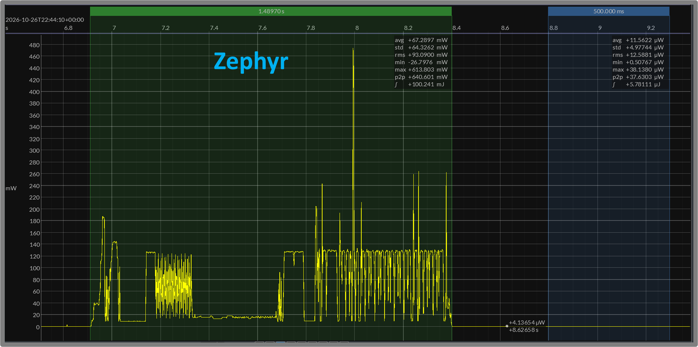
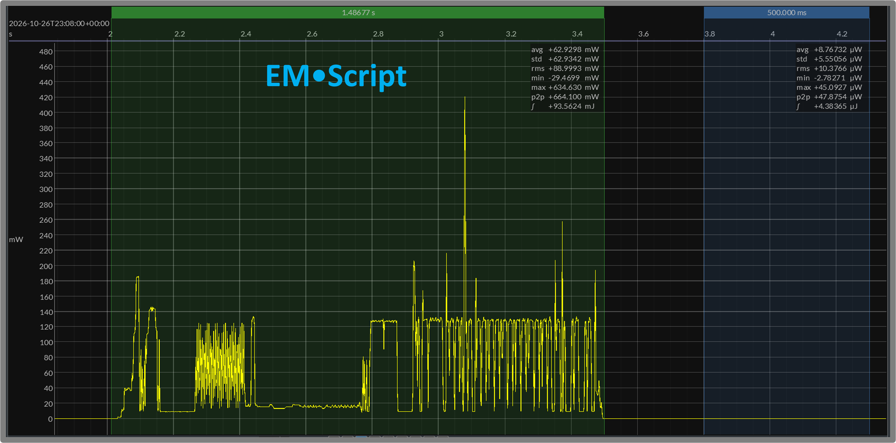

# EMR 14 — nRF91 Modem Host: Zephyr versus EM•Script

**Report date:** 2026-10-26  
**Status:** Draft — engineering results, point-in-time snapshot  
**Target:** Nordic nRF9151 DK, Arm Cortex-M33  
**Measurement setup:** Joulescope JS220, nominal 3.7 V supply  

## TLDR

- Compares Zephyr and EM•Script on the same nRF9151 DK.
- Measures periodic NB-IoT UDP sends at **3.7 V**.
- Both send **20 bytes approximately every 10 seconds**.
- Both reuse an open UDP socket between sends.
- Nordic’s closed modem firmware remains unchanged.
- Zephyr uses Nordic’s libmodem host library.
- EM•Script hosts the modem through shared memory and IPC.
- Both boot through TF-M into a non-secure application.
- EM•Script executes from SRAM with instruction cache disabled.
- EM•Script retains **one 32 KB SRAM block**.
- Mean send energy: **EM•Script 93.34 mJ; Zephyr 98.76 mJ**.
- Send windows exclude startup and network registration.
- Sleep current: **EM•Script 2.44 µA; Zephyr 2.98 µA**.
- Sleep measurements include application and modem cores.
- Code, constants, and tables: **4.54 KB versus 82.33 KB**.
- Complete stored applications: **10.32 KB versus 83.83 KB**.
- Modem shared memory: **5.74 KB versus 17.77 KB**.
- Application sizes exclude TF-M and closed modem firmware.
- Comparable modem energy leaves far more resources for the application.

[← EM•Reports index](README.md)

## 1. Purpose and Comparison Scope

This report compares Zephyr and EM•Script implementations of a periodic NB-IoT UDP workload on the same Nordic nRF9151 DK. Both send a 20-byte payload approximately every 10 seconds, reuse an open UDP socket, and return to sleep between sends.

The comparison focuses on the application processor’s modem-host software. Zephyr uses Nordic’s libmodem library. EM•Script implements a specialized host path that communicates directly with the modem through shared memory and IPC. Both use Nordic’s unchanged closed modem firmware and cellular stack.

The measurements examine send-event energy and duration, sleep consumption, application code and data, and modem shared memory. The EM•Script configuration executes from SRAM and retains one 32 KB SRAM block.

The central question is how many application-processor resources can be recovered while preserving the same essential modem behavior and comparable transaction energy.

## 2. Hardware and Software Implementations

Both implementations run on the nRF9151 DK’s Arm Cortex-M33 application processor. Nordic’s modem firmware handles the cellular protocol stack and radio operation. The application processor configures the modem, manages the UDP socket, supplies outgoing data, and services modem requests and notifications.

### Zephyr Reference

The reference derives from Nordic’s UDP sample in nRF Connect SDK 3.0.2. It uses Zephyr’s kernel, Nordic’s LTE link-control support, and libmodem to provide the application-side modem interface.

The measured configuration selects NB-IoT, requests Power Saving Mode (PSM), and enables Release Assistance Indication (RAI). Serial output is disabled.

### EM•Script Implementation

The EM•Script application uses a specialized synchronous modem host without linking libmodem. It implements the shared-memory and IPC exchanges needed for initialization, network registration, socket creation, connection, and repeated UDP sends.

The host sleeps while waiting for modem responses. After send completion, it continues servicing modem traffic until the modem reports the connection idle, then returns to the application’s periodic sleep cycle.

The measured application executes from SRAM. Its code, constants, writable data, modem shared memory, and stack fit within one 32 KB SRAM block. The remaining application SRAM blocks are powered down.

### Secure Startup

Both implementations boot through Trusted Firmware-M (TF-M) before entering the non-secure application. The EM•Script SRAM build uses a TF-M variant that disables the instruction cache and its profiling counters. The Zephyr reference uses the cache-enabled secure image.

## 3. Periodic UDP Workload

Both applications configure NB-IoT operation, register with the network, and open a connected UDP socket. Once initialized, they repeatedly send a 20-byte payload to the same destination, `8.8.8.8:2469`, without closing the socket or repeating registration.

The steady-state workload is:

```text
periodic wakeup
→ send 20-byte UDP payload
→ service modem activity
→ return to sleep
```

Both implementations request PSM and use `RAI_LAST` to indicate that no further application traffic is expected immediately after the send. The network determines the resulting radio activity and release timing.

The nominal send period is 10 seconds. EM•Script’s aligned ticker produces approximately 10-second start-to-start intervals. The current Zephyr reference produces approximately 10.13-second intervals, including an experimental 100 ms delay before each send.

The measured send window covers the activity associated with an individual transmission through the return to settled sleep. Initial boot, modem initialization, network registration, and socket setup are excluded. Sleep consumption is measured separately between sends.

This is an outgoing UDP workload. The measurements establish host-side send operation and its power behavior; they do not establish delivery to a receiving application.

## 4. Code and Memory Footprint

The footprint comparison uses the build outputs for the measured configurations: Zephyr executing from flash and EM•Script executing from SRAM. All sizes below are bytes. Application-image figures exclude TF-M and Nordic’s closed modem firmware.

| Application footprint | Zephyr | EM•Script |
|---|---:|---:|
| Code, constants, startup, and tables | 82,328 | 4,540 |
| Complete stored application | 83,828 | 10,324 |
| Modem shared memory | 17,768 | 5,736 |

EM•Script uses approximately **18× less code-and-constant storage**. Counting initialized data as part of the stored application reduces that ratio to approximately **8×**. Both comparisons describe the complete application-side implementation rather than the modem-host library alone.

### EM•Script Image Breakdown

| Component | Bytes |
|---|---:|
| SRAM-resident code | 3,936 |
| SRAM-resident constants | 436 |
| Flash bootstrap | 168 |
| Initialized writable data | 5,784 |
| Zero-initialized data (BSS) | 84 |

The stored application totals 10,324 bytes, including the flash bootstrap and the initial contents copied into SRAM. BSS requires runtime memory but no stored initialization bytes.

SRAM-resident code, constants, initialized data, and BSS total **10,240 bytes**, excluding the runtime stack. The complete running application fits within one retained 32 KB SRAM block.

### Modem Shared Memory

The specialized host reduces the transmit and receive buffers while preserving the required control structure and padding.

| Shared-memory component | Zephyr | EM•Script |
|---|---:|---:|
| Control | 1,256 | 1,256 |
| Transmit buffer and padding | 8,320 | 384 |
| Receive buffer | 8,192 | 4,096 |
| **Total** | **17,768** | **5,736** |

This is approximately **68% less modem shared memory**. The EM•Script allocation is already included in its writable-data footprint; it is not an additional allocation.

For context, the linked portion of Nordic’s libmodem contributes **12,638 bytes of code and 406 bytes of constants** in the Zephyr reference. Those figures describe the library contribution, whereas the application totals above include the surrounding kernel, platform support, and application logic.

## 5. UDP Send Energy and Timing

The send-event measurements use the same nRF9151 DK, a nominal 3.7 V supply, and a Joulescope JS220. Each capture contains four complete sends. The windows include modem activity through the return to sleep, excluding initial boot, network registration, and socket setup.

| Mean across four sends | Zephyr | EM•Script |
|---|---:|---:|
| Event energy | 98.76 mJ | 93.34 mJ |
| Event duration | 1.445 s | 1.407 s |

Individual event energies range from **95.46 to 102.92 mJ** for Zephyr and **91.90 to 95.66 mJ** for EM•Script.

The EM•Script sample averages approximately 5.5% less energy. However, the measurements use a live cellular network, and repeated captures showed variation without firmware changes. The supported conclusion is comparable send-event energy; these samples do not establish a repeatable host-software energy advantage.

### Representative Send Events

Figures 1A and 1B show the event closest to each implementation’s mean energy. Both use the same power scale. The green selection covers the send event; the blue selection covers 500 ms of subsequent sleep, discussed in Section 6.



*Figure 1A. Zephyr: the selected send consumes 100.241 mJ over 1.48970 s.*



*Figure 1B. EM•Script: the selected send consumes 93.5624 mJ over 1.48677 s.*

The figure selections use manually placed markers. The table averages use activity-based boundaries applied consistently across all four events. Small differences in the placement of boundaries affect reported duration more than energy because the surrounding sleep power is low.

The waveforms show similar sequences of modem activity and a return to low sleep consumption. EM•Script replaces the application-side host implementation while retaining the same modem firmware and essential UDP workload.

## 6. Deep Sleep and SRAM Retention

Between sends, the modem remains registered with the network in PSM while the application processor waits for its next periodic wakeup. The measured sleep consumption includes both cores and the circuitry supplied through the DK’s `VDD_nRF` measurement path.

| Mean over settled inter-send sleep windows | Zephyr | EM•Script |
|---|---:|---:|
| Sleep current | 2.98 µA | 2.44 µA |
| Sleep power | 11.01 µW | 9.02 µW |

EM•Script’s measured sleep current is approximately **18% lower** than the Zephyr reference. These values average the settled intervals between sends, excluding 500 ms at each end.

The blue selections in Figures 1A and 1B illustrate shorter, 500 ms sleep windows. Their average powers are **11.56 µW for Zephyr** and **8.77 µW for EM•Script**. These representative selections are distinct from the longer-window averages in the table.

### Retaining Less Application SRAM

The EM•Script configuration keeps one 32 KB application SRAM block powered and disables the remaining seven blocks. That block contains the SRAM-executing application, its constants and writable data, modem shared memory, and stack.

The instruction cache and its profiling counters are disabled. Nordic specifies that a disabled cache draws no current and does not retain its contents.

The final comparison measures the configurations as a whole. The modem’s own sleep contribution has not been measured separately. The observed reduction therefore applies to the combined supply current; it is not a percentage reduction attributed solely to the M33.

## 7. What the Result Means for Applications

The modem performs essentially the same work in both implementations. It runs the same Nordic firmware, communicates with the cellular network, and sends the same application payload. Replacing the host software does not remove that radio and protocol cost.

The principal EM•Script result is the application-side footprint. The specialized host performs the required workload with approximately 4.54 KB of code and constants, substantially smaller modem buffers, and one retained 32 KB SRAM block. It reaches comparable send-event energy while leaving more application-processor resources available for useful work.

### Beyond Periodic Sends

This benchmark gives the application processor little work beyond driving the modem. A deployed telemetry application may wake much more frequently than it transmits:

```text
sample sensors
→ update history
→ filter or evaluate measurements
→ decide whether a report is needed
→ transmit or return to sleep
```

Smaller host software leaves more room for those functions. Reduced modem shared memory makes additional SRAM available for sensor buffers, history, and application state. The current implementation also demonstrates that the complete application can execute from SRAM within a single retained block.

The measured reduction in sleep consumption matters between transmissions. For applications that send infrequently, those intervals can account for most of the operating time.

Additional host-side computation may create further energy opportunities through specialization and SRAM execution. Those opportunities are not measured by this elementary UDP workload and should be evaluated with application-specific benchmarks.

The demonstrated result is therefore a smaller application-side foundation for cellular products: comparable modem transaction energy, lower measured sleep consumption, and more resources available to the application.

## 8. Caveats and Conclusions

These results describe the measured builds and selected UDP workload. They are engineering comparisons, not official benchmark scores or minimum achievable implementations.

The principal limits are:

- Send-energy averages cover four events per implementation.
- Live cellular-network conditions vary between events and captures.
- Selected waveforms illustrate individual events, not the averages.
- The specialized EM•Script host does not provide full libmodem coverage.
- Long-duration reliability and broader application workloads remain untested.

Within that scope, EM•Script performs the same essential modem workload with comparable send energy, lower measured sleep consumption, and substantially smaller application-side footprints.
